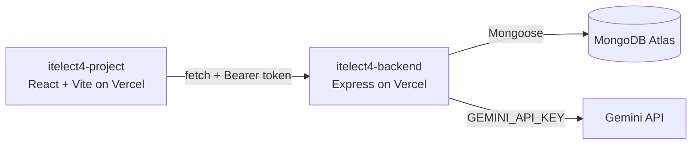

# Campus Lost & Found — Frontend (ITELECT4)

[](https://github.com/Magne1025/itelect4-project/actions/workflows/ci.yml)

A responsive, professional React and TypeScript web application for a University Lost & Found Campus Information System. Finders post cataloged items, owners submit verification claims, and administrators review submissions and users.

## Architecture




## 🚀 Live Deployments

- **Live Frontend Web App (Vercel):** [https://itelect4-project-green.vercel.app](https://itelect4-project-green.vercel.app)
- **Live Backend API (Vercel):** [https://itelect4-backend-amber.vercel.app](https://itelect4-backend-amber.vercel.app)
- **GitHub Repository (Frontend):** [https://github.com/Magne1025/itelect4-project](https://github.com/Magne1025/itelect4-project)
- **GitHub Repository (Backend):** [https://github.com/Magne1025/itelect4-backend](https://github.com/Magne1025/itelect4-backend)

---

## 🛠️ Tech Stack & Libraries

- **Framework & Tooling:** React 19, Vite, TypeScript
- **Styling & UI:** Tailwind CSS, Shadcn UI, Glassmorphism design system
- **State & Data Management:** TanStack Query (React Query v5), Zustand with persistent store
- **Form Validation:** React Hook Form, Zod schema validation
- **Routing:** React Router v7 with route protection

---

## 🔑 Demo Admin Credentials

For reviewing and administrative testing:
- **Email:** `admin@campus.edu`
- **Password:** `adminpassword123`
- **Role:** `admin`

---

## 🌟 Key Features

- **Campus Feed & Catalog:** Browse, search by keyword/location, and filter by status and category.
- **Report Item Flow:** Multi-field form including title, category, location, Philippine contact number regex validation, detailed description, and image upload.
- **Ownership Claims:** Submit ownership verification details for reviewed item return.
- **Admin Dashboard:** Real-time statistics, pending claims management, and user active status controls.
- **Persistent State & Token Auth:** Secure JWT bearer token integration with automatic session caching in Zustand.
- **AI Project & Report Review:** Interactive Gemini AI feedback assistant on `/review` with live readiness status badges, strengths, and actionable improvements.

---

## ⚙️ Environment Variables

Create `.env` at the project root:

```env
VITE_API_URL=https://itelect4-backend-amber.vercel.app
```

*(For local testing with local backend, use `VITE_API_URL=http://localhost:4000`)*

---

## 🏃 Local Development

Install dependencies:
```bash
npm install
```

Start the Vite development server:
```bash
npm run dev
```

Run TypeScript compiler check:
```bash
npx tsc -b
```

Build for production:
```bash
npm run build
```

Run test suite:
```bash
npm test
```

---

## 🤖 AI-Use Disclosure
AI coding assistants were utilized during the development of this project for pair programming, code scaffolding, automated testing setup (Vitest and React Testing Library), CI workflow configuration, and code quality linting assistance. All generated code and tests have been reviewed, verified, and validated.

